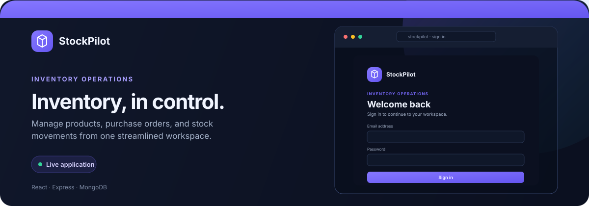

# Inventory Management System

<p align="center">
  <a href="https://inventory-management-system-seven-pearl.vercel.app">
    
  </a>
</p>

A full-stack inventory management web application built with React, Vite, Express, and MongoDB for managing products, suppliers, categories, purchase orders, stock movement, and employee/admin workflows.

## Live Demo

- Frontend: https://inventory-management-system-seven-pearl.vercel.app
- Backend API: https://inventory-management-system-ra95.onrender.com/api/v1

## Overview

This project is designed for businesses that need a practical way to track stock levels, manage vendors, and process purchase orders without heavy enterprise software. The system includes:

- product catalog management
- supplier and category tracking
- purchase order creation and receiving
- stock adjustments, sales, returns, and damage logging
- dashboard metrics for inventory health
- admin controls for employee permissions and status
- secure JWT authentication with HTTP-only cookies

## Tech Stack

### Frontend
- React 18
- Vite
- React Router
- Tailwind CSS
- Axios
- Recharts
- Lucide React
- Sonner

### Backend
- Node.js
- Express.js
- MongoDB + Mongoose
- JWT
- bcryptjs
- express-validator
- helmet
- express-rate-limit
- cookie-parser
- CORS

## Features

### Authentication & access control
- user registration and login
- refresh-token-based session management
- role-based UI and backend access control
- employee permission management for admin users
- account activation/deactivation

### Catalog management
- create, edit, list, and view products
- category management
- supplier management
- product filtering by stock state

### Purchase orders
- create purchase orders with multiple ordered items
- update pending purchase orders
- receive stock against a purchase order
- cancel pending purchase orders
- track partial vs complete receiving

### Inventory operations
- purchase receipt
- sale
- return
- damage
- manual adjustment
- transaction history with before/after quantities

### Dashboard
- total product count
- active product count
- low-stock and out-of-stock counts
- inventory value summary
- recent transactions
- recent purchase orders

## Project Structure

```text
inventory-management-system/
├── backend/
│   ├── src/
│   │   ├── config/
│   │   ├── constants/
│   │   ├── controllers/
│   │   ├── middleware/
│   │   ├── models/
│   │   ├── routes/
│   │   ├── services/
│   │   ├── utils/
│   │   ├── validators/
│   │   ├── app.js
│   │   ├── generate.js
│   │   └── server.js
│   ├── .env
│   ├── package.json
│   └── README.md
├── frontend/
│   ├── src/
│   ├── public/
│   ├── index.html
│   ├── package.json
│   ├── vite.config.js
│   └── .env.example
├── .gitignore
├── README.md
├── FRONTEND_SPEC.md
└── .env.example (optional at root if used)
```

## Setup

### 1) Clone the repository

```bash
git clone <repo-url>
cd inventory-management-system
```

### 2) Install backend dependencies

```bash
cd backend
npm install
```

### 3) Install frontend dependencies

```bash
cd ../frontend
npm install
```

## Environment Variables

### Backend (`backend/.env`)

```env
PORT=5000
MONGO_URI=mongodb://localhost:27017/inventory-system
JWT_ACCESS_SECRET=your_access_secret
JWT_REFRESH_SECRET=your_refresh_secret
JWT_ACCESS_EXPIRES_IN=15m
JWT_REFRESH_EXPIRES_IN=30d
NODE_ENV=development
FRONTEND_URL=http://localhost:5173
```

### Frontend (`frontend/.env`)

```env
VITE_API_URL=http://localhost:5000/api/v1
```

## Run the Application

### Start backend

```bash
cd backend
npm run dev
```

### Start frontend

```bash
cd frontend
npm run dev
```

The frontend usually runs at `http://localhost:5173` and the backend runs at `http://localhost:5000`.

## API Base URL

The backend API is served under:

```text
/api/v1
```

Examples:
- `/api/v1/auth/login`
- `/api/v1/products`
- `/api/v1/categories`
- `/api/v1/purchase-orders`
- `/api/v1/inventory-transactions`
- `/api/v1/dashboard`

## Authentication Notes

- authentication uses HTTP-only cookies
- tokens are not stored in localStorage or sessionStorage
- the frontend uses an Axios refresh interceptor for `401` handling
- backend authorization is enforced for protected routes and admin-only operations

## Current Status

The repository includes:
- a working backend API for inventory and admin features
- a React frontend app shell with auth and core routing
- dashboard and catalog/inventory integration points
- role-aware and permission-aware backend logic

## Notes

- The backend is the source of truth for API contracts, validation, and authorization.
- Frontend UI should align with the actual backend behavior rather than assumptions.
- This project is suitable for a portfolio or demo application and is structured for extension.

## License

This project is for educational/demo purposes unless otherwise specified by the repository owner.
